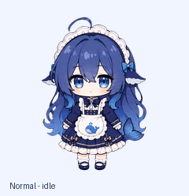
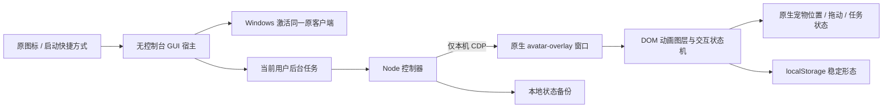

# Codex Native Pet Bridge

在 **Windows 的 Codex 原生悬浮宠物窗口**中扩展动画、交互和持久形态的运行时桥接。

本项目通过仅绑定本机的 Chrome DevTools Protocol（CDP）连接，在原有宠物容器里挂载动画图层。继续使用已安装的日常客户端、原账号与原配置，**不修改 EXE、ASAR、签名或 WindowsApps 权限**，也不运行第二个桌面宠物播放器。

示例 **Deepseek 酱 V2** 支持双击炸盆扣头、其他动作持续戴盆、工作时猛吃白饭、悬停单次哈气，以及重启恢复形态。



> 非官方扩展，未获 OpenAI 或 DeepSeek 背书。它依赖客户端当前的窗口和 DOM 结构，不是受官方兼容性承诺保护的宠物 API。示例角色图片单独署名，**不适用代码的 MIT 许可**，详见[素材说明](examples/deepseek-v2/ASSET-LICENSE.md)。

## 功能

| 触发 | 普通形态 | 戴盆形态 |
| --- | --- | --- |
| 双击宠物身体 | 播放炸盆动画，最后一帧完成后戴盆并保存 | 恢复普通形态并保存 |
| Running | 连续抱盆吃饭 | 戴盆连续吃饭 |
| 鼠标移入 | 播放一次空盆哈气，恢复最新任务动作 | 戴盆哈气，结束后继续当前动作 |
| 鼠标停在宠物上 | 不重复哈气 | 不重复哈气 |
| 移开再移入 | 可重播 | 可重播 |
| Failed | 原 V1 失败动作 | 原 V1 失败动作叠加逐帧头盆 |
| 其他原生动作 | 保留原有动作 | 按头部锚点保留头盆 |
| 重启或 renderer 重建 | 恢复最后保存的稳定形态 | 恢复最后保存的稳定形态 |

拖动仍由原生客户端处理。变身期间不重复触发变身；哈气结束后恢复**此刻最新**的任务动作，而不是播放前的旧动作。

## 环境要求

- Windows x64，已安装 `OpenAI.Codex` 打包桌面客户端，能够显示原生宠物。
- Node.js **22 或更新版本**，需要内置 `fetch`、`WebSocket`，无需安装 npm 依赖。
- PowerShell **7**，`node.exe`、`pwsh.exe` 在 PATH 中。
- Windows 自带的 .NET Framework C# 编译器，用于本地构建无控制台宿主。
- 普通用户权限。安装器会拒绝管理员方式运行。

当前 Windows 适配器通过应用包激活接口打开同一个原客户端。不支持自动定位普通解压版、macOS 或 Linux 客户端。纯逻辑测试可以跨平台运行。

## 快速开始

### 1. 获取源码

```powershell
git clone https://github.com/wanfeng562-code/codex-native-pet-bridge.git
cd codex-native-pet-bridge
npm test
npm run verify-assets
```

没有第三方 npm 运行依赖，不需要 `npm install`。不要把其他实验客户端或登录配置复制到项目里。

### 2. 打开原客户端的本机连接

先保存工作并完整退出客户端，然后在 PowerShell 7 运行：

```powershell
pwsh -NoProfile -File .\bridge\open-client.ps1
```

这会通过 Windows 激活原应用，传入：

```text
--remote-debugging-address=127.0.0.1 --remote-debugging-port=46873
```

不会创建另一套用户目录，也不会复制账号。客户端已经打开且没有本机连接时，脚本会停止并说明原因，**默认不会关闭你的窗口**。

`open-client.ps1 -RestartClient` 是显式强制重启选项，会结束该安装包的客户端进程；仅在已经保存工作且明确需要时使用。

### 3. 找到宿主宠物 ID

在原客户端选择并显示一个原生宠物，然后运行：

```powershell
node .\tools\inspect-pet.mjs
```

示例输出：

```json
{
  "petId": "pet_your_selected_pet_id",
  "action": "idle"
}
```

这里只读取原生图层上的宠物 ID 与动作状态，不读取聊天正文。每个账号的自定义宠物 ID 可能不同，不能使用他人的 ID。

桥接只在这个 ID 被选中时显示 Deepseek 示例；选择其他宠物时会卸载自己的图层。此处的宿主是原客户端已经存在的宠物，桥接不会创建或上传云端宠物。示例素材的几何尺寸是 8×9 网格，每帧 192×208，宿主显示区域的比例应与之兼容。

### 4. 安装无窗口后台和快捷方式

把上一条输出的实际 ID 填进下面的命令：

```powershell
pwsh -NoProfile -File .\setup.ps1 -PetId pet_your_selected_pet_id
```

安装器会：

1. 检查 Node 版本并校验配置。
2. 将本机路径和选中 ID 写入被 Git 忽略的本地配置。
3. 从 `bridge/BridgeHost.cs` 编译 Windows GUI 子系统宿主。
4. 创建当前用户的 `CodexNativePetBridge` 登录任务，权限为 Limited。
5. 生成 `Start Codex Pet.lnk` 和 `Disable Codex Pet.lnk`，使用原客户端图标。
6. 启动桥接，连接当前原生宠物窗口。

这些生成文件均不进入 Git。若要让**已有开始菜单快捷方式**也前置桥接，可显式安装：

```powershell
pwsh -NoProfile -File .\setup.ps1 -PetId pet_your_selected_pet_id -UpdateStartMenu
```

仅修改指向同一原客户端的 `.lnk`，修改前备份；不修改任务栏固定数据库或其他应用入口。使用 `-NoStart` 可准备任务和快捷方式而不立即启动控制器。

如果运行的是早期私有实验版本，请先使用其停用入口，避免两个控制器同时操作同一原生窗口。安装器检测到正在运行的旧版任务时会停止。

### 5. 日常使用

双击 `Start Codex Pet.lnk`。它先打开同一个日常客户端，再启用桥接后台。GUI 宿主通过 `CreateNoWindow` 启动子进程，**不会留下 PowerShell、CMD 或 Windows Terminal 窗口**。

PowerShell 只在启动阶段短暂、无窗口地执行应用定位；常驻后台为小型 GUI 宿主和 Node 控制器。客户端关闭时控制器等待，下次通过桥接入口启动后自动连接。

旧任务栏固定图标可能按系统应用标识直接激活客户端，**不会自动继承开始菜单的启动参数**。要从任务栏启动桥接，请固定本项目生成的启动快捷方式，并取消旧固定项。Windows 的应用分组方式可能仍导致运行时图标合并或出现第二个图标，本项目不强改 Explorer 数据库。

## 桥接如何工作



具体步骤：

1. 查询 `127.0.0.1:<port>/json/list`，筛选 `app://` 的 `avatar-overlay` 页面。
2. 只接受对应端口、无账号密码的 `ws://127.0.0.1/.../devtools/page/` 连接。
3. 用 `Runtime.evaluate` 安装我们自己的 renderer 函数和校验后的图集。
4. 找到 `[data-testid="avatar-mascot-button"]` 及带 `data-codex-pet-id`、`data-codex-pet-state` 的图层。
5. 仅当宠物 ID 匹配时隐藏原精灵，向同一个容器加入 `pointer-events: none` 的动画层。
6. 独立播放动画、保存稳定形态，并跟随原生动作、窗口尺寸及位置。
7. 停用、换宠物、隐藏宠物或心跳超时后移除图层，恢复原精灵透明度。

没有使用 React 私有状态，也没有重打包应用。MCP、Skill 或聊天指令不是双击/悬停的触发链路，鼠标交互直接发生在原生宠物窗口。

更多实现细节见 [架构说明](docs/ARCHITECTURE.md)。

## 原生动作槽位

| 槽位 | 图集行 | Deepseek V2 示例 |
| --- | ---: | --- |
| `idle` | 0 | 普通待机 / 戴盆待机 |
| `running-right` | 1 | 原版向右走，戴盆时逐帧跟踪 |
| `running-left` | 2 | 原版向左走，戴盆时逐帧跟踪 |
| `waving` | 3 | 原版招手，保留形态 |
| `jumping` | 4 | 原版跳跃，保留形态 |
| `failed` | 5 | V1 失败动作，保留形态 |
| `waiting` | 6 | 原版等待，保留形态 |
| `running` | 7 | 持续抱盆吃饭，8 帧 |
| `review` | 8 | 原版完成/检查动作，保留形态 |

`hissing` 与 `transforming` 是桥接增加的独立播放阶段，不占用原生九槽位。悬停哈气采用独立图集的普通/戴盆两行，失败槽不再绑定哈气。

Running 主要跟随原生状态。原生状态偶尔保持 Idle 时，控制器会只读检查聊天窗口是否显示可用的“停止”按钮，将得到的布尔值作为工作补偿信号。这不是 token 余额接口，不知道真实额度或精确 token 消耗。

## 示例与自定义

- [Deepseek V2 示例说明](examples/deepseek-v2/README.md)：图集、时序、头盆锚点和素材来源。
- 下载仓库后，可直接在浏览器打开 [离线动画预览](examples/deepseek-v2/preview.html)。这个预览不连接客户端。
- `bridge.config.example.json` 展示配置格式；实际配置位于 `bridge/config.local.json`。
- `assetDir` 必须位于仓库内。当前播放几何固定为 8×9，替换角色时需要同步调整图集、帧数、时长、头部锚点及 SHA-256 清单。
- 修改图集后运行 `node tools/verify-assets.mjs --write` 更新清单，再重新验证。

仅导入一张静态图集不会获得双击变身和状态持久化；这些行为来自桥接状态机。

## 停用、恢复与更新

双击 `Disable Codex Pet.lnk`，或运行：

```powershell
pwsh -NoProfile -File .\bridge\stop-bridge.ps1
```

控制器请求退出，禁用自己的登录任务，恢复已备份的开始菜单入口；原图层通常立即恢复，控制器意外断开时最多等待约 8 秒心跳租期。保存的普通/戴盆形态仍保留，再启动可继续恢复。

更新本项目前先停用，避免覆盖正在运行的宿主。拉取源码后重新运行安装命令，从源码构建 GUI 宿主。原客户端更新不需要重新打 EXE/ASAR 补丁，但如果新版改了 DOM、窗口 URL 或调试能力，就可能需要适配。

要完整移除：先停用，再在任务计划程序中删除本项目的 `CodexNativePetBridge` 任务，最后删除本项目目录。请在快捷方式恢复后再删除目录；不要删除客户端或账号配置。

## 诊断与测试

```powershell
npm test
npm run verify-assets
node .\tools\inspect-pet.mjs 46873
node .\bridge\controller.mjs status
```

本地诊断文件在 `bridge/.runtime/`：`status.json`、`state.json`、`host.json`、`events.jsonl`、快捷方式备份等。它们只用于本地排查，不应上传；事件记录会随使用增长，可在停用后清理。

CI 在 Windows/Linux 运行逻辑与图集校验，在 Windows 编译 GUI 宿主。当前原生客户端实测范围和仍需验证的部分见 [验证记录](docs/VALIDATION.md)，常见问题见 [排障](docs/TROUBLESHOOTING.md)。

## 隐私与权限范围

运行时没有遥测、上传、GitHub 请求或账号迁移。它读取宠物 DOM 状态，以及工作窗口“停止”按钮是否存在的布尔值，不读取提示词、回答正文或聊天数据库。

**本机 CDP 是功能强大的调试接口，并不是宠物专用的权限隔离边界。** 同一台机器上的进程可能访问这个接口；不要将其绑定到外网、转发到公网或在不可信的共享电脑上启用。不应向桥接加载不可信的 JS 图集元数据或 renderer 代码。

## 许可与致谢

本项目原创代码、文档采用 [MIT](LICENSE)。示例图片及其衍生预览不包含在 MIT 授权中；原始 `deepseek酱` 来自 Petdex 的 **fightingshine** 投稿，详细来源和未确认的素材授权状态见 [第三方声明](THIRD_PARTY_NOTICES.md)。

运行时桥接方案的调查参考了 [JasonSTong/codex-theme-studio](https://github.com/JasonSTong/codex-theme-studio) 与 [GiantClam/codex-theme-studio-skill](https://github.com/GiantClam/codex-theme-studio-skill) 的公开方法记录。本仓库不分发 Codex 程序副本、提取的客户端 bundle 或登录配置。

## English overview

A Windows-only runtime bridge that extends the **existing native Codex pet window** through a loopback CDP session. It overlays a validated sprite layer inside the native container, adds a two-form state machine and mouse interactions, and persists only completed form changes. No EXE/ASAR patching, alternate client profile, or second pet window is required.

The Deepseek V2 demo includes rice eating while Running, a single hover hiss, a double-click basin transformation, helmet tracking during other actions, and restart restoration. The source code is MIT; the separately credited third-party character artwork is **not** covered by that license. See the notices before reusing images.
