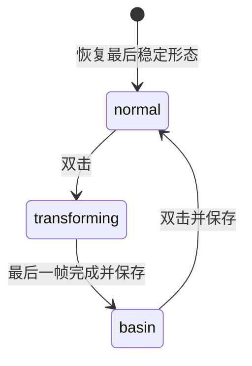

# 运行时桥接架构

## 边界

原生客户端负责透明窗口、桌面位置、拖动、任务通知和原生动作状态。Node 控制器负责本机连接、图集验证、renderer 注入、心跳和状态备份；renderer 负责动画时序、鼠标手势、服装锚点及 localStorage。GUI 宿主负责无窗口运行进程，不参与动画逻辑。

这是现有客户端的运行时图层扩展，不是对其播放器二进制做补丁，也不是一个 MCP 宠物播放器。

## 形态与动作是两个维度

`form` 只包含 `normal`、`basin`。`phase` 包含 `stable`、`transforming`。原生动作持续独立更新；高优先级片段结束后重新读取最新动作。

优先级：变身 > 单次悬停哈气 > 原生动作（带工作状态补偿）。变身时忽略重复双击，不把中间帧保存为新形态。每次转换使用 generation 标识，旧动画的完成回调无法提交新状态。

戴盆行 0 与行 7 已将头盆绘入图集；其他行使用 45 个逐帧锚点，对独立的盆子纹理做平移、缩放与旋转。这样无需给每个动作重新绘制角色身体，也不会因换动作而丢掉形态。

## 鼠标事件

双击识别基于 `pointerdown`/`pointerup`：同一指针、主按钮、位移不超过 5px、两次间隔不超过 550ms。带修饰键、通知按钮、拖动及取消事件不会触发变身。

合格点击结束时向原生捕获元素发出标准 `pointercancel`，让原生拖动逻辑清理捕获状态，同时避免其单击行为弹出聊天面板。拖动没有这一步。这里依赖当前客户端的事件处理语义，后续版本需重新验证。

悬停以一次进入为一个消费周期；停住不会重播，实际离开宠物矩形才重新武装。透明像素的命中变化不算离开。离开不会截断已开始的哈气；重新进入产生新的 generation，避免旧回调结束新动画。双击或拖动会取消哈气。

原生悬停有时会把动作标记为 `jumping`。哈气结束而鼠标仍在宠物内时，桥接根据可见的任务状态和工作布尔值恢复 Running/等待/完成/Idle，避免停留在悬停动作。

## 播放与持久化

动画使用逐帧 `setTimeout`，时长来自 `asset-data.mjs`；Running 会持续循环。`prefers-reduced-motion` 下减少播放，单次片段完成后仍能切回正确状态。

稳定形态写到独立 localStorage 键 `codex-native-pet-bridge:v1:<petId>`，并由控制器备份到 `.runtime/state.json`。有效的 renderer 本地状态优先，磁盘状态作为备份。只保存两种稳定形态，不保存 token、提示词或变身中的临时帧。

控制器每约 1.5 秒轮询并刷新租期。renderer 超过 8 秒没有心跳会撤销自己的图层，恢复原精灵。DOM 重建后重新寻找容器并挂载；选中其他宠物时卸载，ID 再次匹配后恢复。

## 无窗口宿主

`BridgeHost.cs` 以 `/target:winexe` 编译。快捷方式及登录任务直接调用这个 GUI 子系统程序，而不是先打开 `cmd.exe`/`pwsh.exe`。子进程使用 `UseShellExecute=false`、`CreateNoWindow=true`，标准输出/错误重定向到本地日志。

`controller` 模式启动 Node 并等待退出；`launch` 模式短暂运行启动脚本；`stop` 模式执行停用恢复。宿主仅接受这三个固定模式，不能作为任意命令启动器使用。

## 扩展点

| 文件 | 修改内容 |
| --- | --- |
| `bridge/config.mjs` | ID、端口及路径约束 |
| `bridge/cdp.mjs` | 窗口发现、受限本机连接 |
| `bridge/core.mjs` | 纯状态机、动作计划和手势识别 |
| `bridge/renderer.mjs` | 原生 DOM 适配、动画和交互 |
| `bridge/controller.mjs` | 心跳、注入、状态备份和活动布尔值 |
| `examples/deepseek-v2/assets/asset-data.mjs` | 帧时序、槽位及头盆锚点 |
| `bridge/common.ps1` | Windows 原应用定位与包激活 |

如果客户端改变 DOM，应首先让适配器停止挂载并恢复原图层，再适配选择器。不要通过修改安装包或放宽 WindowsApps 权限来掩盖兼容性问题。
